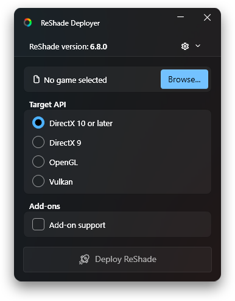
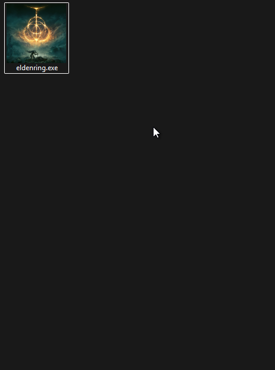

# ReShade Deployer
### A centralized alternative to the official ReShade installer

[](https://github.com/Jobus0/ReShade-Deployer/releases/latest)
[](https://github.com/Jobus0/ReShade-Deployer/releases)
[](../LICENSE.md)
[](https://dotnet.microsoft.com/en-us/download/dotnet/10.0/runtime)

<picture>
  <source media="(prefers-color-scheme: dark)" srcset="Readme/MainWindow_Dark.png">
  <source media="(prefers-color-scheme: light)" srcset="Readme/MainWindow_Light.png">
  
</picture>

## Who is this for?
Those who want to:
- Keep a single shared Shaders folder for all their games instead of downloading new copies with every install.
- Update the .dll:s across all games to the latest version with a single click.
- Have your personal preconfigured ReShade.ini and ReShadePreset.ini files automatically installed.
- Optionally keep all your installed ReShadePreset.ini in a centralized folder.
- Quickly install ReShade from the (right-click) context menu on a game .exe or shortcut.

## Features
A minimal installer program that lets you:
- Pick graphics API (DirectX 10 or later, DirectX 9, OpenGL, Vulkan).
- Automatically pick the rendering API and 32/64-bit versions by analysing the executable.
- Automatically redirect the installation path for Unreal Engine Bootstraps and RTX Remix titles.
- Toggle a checkbox to install the 'Add-on Support' version.
  - When enabled, a dropdown list becomes available for choosing what add-ons to deploy from your 'Add-ons' folder. It automatically picks the correct 32/64-bit file. [Learn more about advanced add-on usage](ADDONS.md).
- Optionally store and manage your game presets centrally in a 'Presets' folder instead of scattering them inside game directories. [Learn more](#centralized-presets).
- Add a 'Deploy ReShade' option to Windows's context (right-click) menu for .exe files and shortcuts.
- Update all deployed ReShade .dll:s with a single click.
  - Possible because it creates symlinks instead of copying the .dll:s.
- Update the program itself with a single click.
- Remove existing ReShade deployments by selecting a game and pressing the trash bin button (only visible if previous deployment exists).
- See clear warnings when you are about to deploy to a game that is known to block or ban ReShade.

## Installation
1. Download the [latest release](https://github.com/Jobus0/ReShade-Deployer/releases/latest).
2. Extract **ReShadeDeployer.exe** anywhere you want it.
   - This is where you must keep your **Shaders**, **Textures**, and **Add-ons** folders.
   - If you already have a folder for **Shaders** and **Textures**, you can place **ReShadeDeployer.exe** in the same folder.
3. Run the program and allow the first-time setup.

### Optional Steps
- Enable [Context menu deploy](#run-from-context-menu) from the **⚙** options menu.
- Enable [Centralized presets](#centralized-presets) from the **⚙** options menu.
- Put a **ReShade.ini** and/or **ReShadePreset.ini** next to **ReShadeDeployer.exe** to make the deployer automatically include those .ini:s when deploying to games.
   - When your custom **ReShade.ini** is deployed, some specific settings (like the search paths) will be overridden or created if missing.
- Put **.addon32** and **.addon64** files in the **Add-ons** folder (either loose or in a subfolder) to make them deployable from the app. See more in [**Advanced Add-ons Usage**](ADDONS.md).

### Folder Structure
```
ReShade
├── lib                             # Contains the ReShade .dll:s, shader cache, and deployer settings. Can be ignored.
├── Shaders                         # Put your shaders here.
│   └── *.fx/fxh
├── Textures                        # Put your textures here.
│   └── *.png
├── Add-ons                         # Put your add-ons here.
│   ├── My Add-on
│   │   └── *.addon32/addon64       # Add-on files grouped in sub-folder
│   └── *.addon32/addon64           # Add-on files loose in Add-ons root
├── Presets                         # Optional: Centralized presets, if enabled in options menu.
├── ReShadeDeployer.exe
├── ReShade.ini                     # Optional
└── ReShadePreset.ini               # Optional
```

## Usage
1. Run the program.
2. Select the game you want to deploy ReShade to using the 'Browse...' button.
3. The target graphics API (DirectX, Vulkan, etc) should be automatically selected. If not, select it manually. If you are unsure, check the API section of the game's [PCGamingWiki](https://www.pcgamingwiki.com/wiki/Home) page.
4. (Optional) Check the Add-on Support toggle and select your add-ons from the dropdown list.
5. Press the 'Deploy ReShade' button.
6. If an existing ReShade preset is detected, it will ask whether to overwrite it.

### Run From Context Menu
To enable this, run the program, and from the **⚙** options menu, toggle the **Context Menu Deploy** option.

Then, right-click any game .exe or shortcut in Windows's file explorer or desktop, and select 'Deploy ReShade'.

<picture>
  <source media="(prefers-color-scheme: dark)" srcset="Readme/Deployment_Dark.webp">
  <source media="(prefers-color-scheme: light)" srcset="Readme/Deployment_Light.webp">
  
</picture>

Note in the video above next to "**DirectX 10 or later**" that there is a "**Detected**" badge, showing that the API was automatically detected by analyzing the game's executable.

### Centralized Presets
By default, deploying ReShade places the `ReShadePreset.ini` directly inside each game's folder. If you prefer to keep all your game presets organized in one central location:

1. Open the **⚙** options menu and enable **Centralized presets**.
2. A **Preset Name** field will appear on the main window. ReShade Deployer will automatically suggest a name based on the selected game's executable.
3. When deployed, the preset will be kept inside a `Presets` sub-folder next to `ReShadeDeployer.exe` rather than inside the game's directory.

> **Tip:** You can assign the exact same preset name to multiple games to have them share and sync the same preset file.

## Uninstallation
1. Use **Uninstall** from the **⚙** options menu in ReShade Deployer.
    - This will remove all ReShade Deployer registry entries and the Vulkan ReShade layer.
2. Delete **ReShadeDeployer.exe**.
